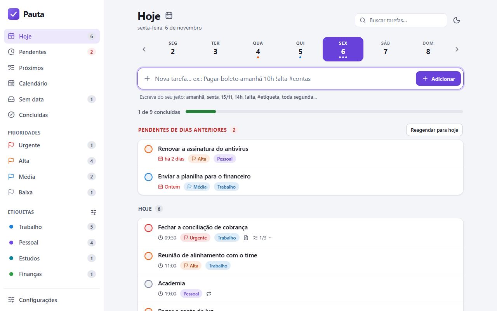
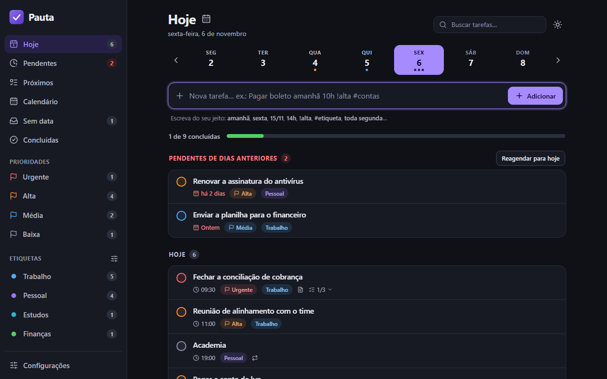
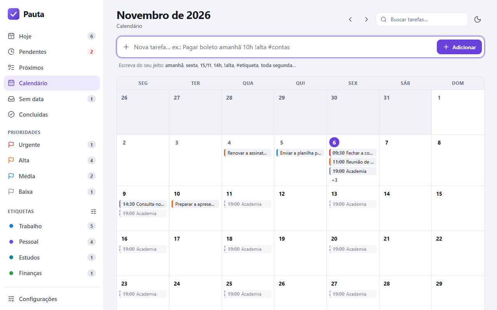
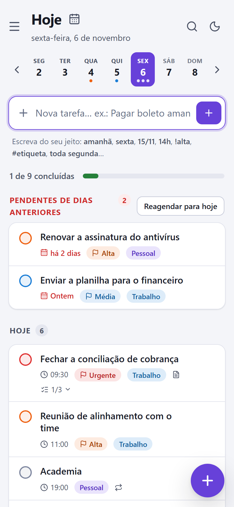

# Pauta

**Agenda de tarefas do dia a dia: simples, rápida e feita para o navegador, até sem internet.**

Escreva a tarefa do jeito que você falaria (`Pagar boleto amanhã 10h !alta #contas`) e o Pauta entende a data, a hora, a prioridade e a etiqueta. Cada tarefa pode ter **checklist** e **anotações**. Roda direto no GitHub Pages, sem servidor e sem rastreamento. Se quiser ver as mesmas tarefas no celular, no notebook e no PC, dá para ligar o **login e a sincronização** (gratuito; a conta pode ser opcional ou obrigatória: [veja como](docs/NUVEM.md)).

> **Abrir o app:** <https://mekea-dev.github.io/pauta/> (para publicar uma cópia sua, veja [Publicar](#publicar-no-github-pages)).

<p align="center">
  
  
</p>

## O que ele faz

- **Agenda do dia**: faixa da semana para navegar entre os dias, progresso do dia e uma seção de **pendentes de dias anteriores** (com **Reagendar para hoje**), que também tem tela própria em **Pendentes**, no menu.
- **Adicionar rápido** em português, com pré-visualização do que foi entendido (clique no X de um item para o app *não* interpretar aquele trecho).
- **Prioridades** (urgente, alta, média, baixa) e **etiquetas** coloridas, com filtros no menu.
- **Checklist** dentro da tarefa: marque os itens direto na lista, cole uma lista de várias linhas e ela vira vários itens.
- **Anotações** dentro da tarefa (links viram atalhos clicáveis).
- **Repetição**: todo dia, dias úteis, dias da semana, a cada N semanas, todo mês, todo ano. Ao concluir, a próxima já é criada; as repetições futuras aparecem esmaecidas na agenda e no calendário.
- **Lembretes** ("despertador"): numa tarefa com data e hora, escolha ser avisado 5 minutos, 1 hora, 1 dia... antes (ou escreva `me avise 15 minutos antes`). Avisa com o app aberto sem configurar nada; com o app fechado (celular), precisa de um pequeno serviço gratuito na Cloudflare: [docs/LEMBRETES.md](docs/LEMBRETES.md).
- **Voz**: o botão do microfone ao lado de Adicionar ouve até você mandar parar (**Parar e enviar**, tocar nele de novo ou apertar Enter; **pausar não envia**, e se o app parar de ouvir sozinho o texto fica no campo para você continuar ou criar) e entende a frase como uma pessoa entenderia ("crie uma tarefa pagar boleto para dia 10 às 16 horas", "tenho reunião amanhã às oito", "daqui a 20 minutos"): tira as hesitações e o pedido, e cria a tarefa (com Desfazer). Quando algo não fica claro, em vez de chutar, abre a janela da tarefa com o que entendeu já preenchido para você completar. Quem transforma a voz em texto é o navegador (o Chrome envia o áudio ao Google). A **IA da fala** vem ligada: o texto falado (só o texto) vai ao serviço do Pauta na Cloudflare, que usa uma IA para organizá-lo **usando só o que você disse** (o que ela inventar é descartado): numa frase longa, um **título resumido** e o resto nas **Anotações** da tarefa; e ela entende se você quer **criar** uma tarefa nova ou **concluir, alterar ou excluir** uma que já existe ("já paguei a conta de luz desse mês", "muda a reunião de sexta para segunda às três", "apaga a tarefa do dentista"): quem acha a tarefa é o seu aparelho (os títulos das suas tarefas não saem dele), concluir tem Desfazer e alterar e excluir pedem confirmação. Cada aparelho pode desligar a IA em Configurações (aí nada do que você fala sai do aparelho e a frase vira sempre uma tarefa nova), e se ela falhar ou demorar o app usa as regras. No app da Tela de Início do iPhone o reconhecimento de voz do navegador é um recurso não oficial do iOS: o Pauta tenta e, se o iPhone recusar, avisa e passa para o microfone do teclado.
- **Calendário** do mês, **Próximos dias**, **Pendentes**, **Sem data**, **Concluídas** e **busca** (título, anotações, etiquetas e checklist).
- **Desfazer** (aviso na tela e `Ctrl+Z`), atalhos de teclado e **tema claro, escuro ou automático** (botão no topo da tela).
- **Arrastar a tarefa (celular)**: arraste a linha para a direita para concluir (ou reabrir) e para a esquerda para excluir. Só vale se você arrastar e soltar depois do limite (soltar antes volta ao lugar; um toque ou a rolagem não fazem nada), e o aviso tem **Desfazer**.
- **Conta** (opcional, ou obrigatória se você preferir): login por e-mail e senha para ver as mesmas tarefas em todos os aparelhos, com sincronização automática (Firebase, plano gratuito). A conta nova **começa zerada** (sem tarefas nem etiquetas de exemplo). Passo a passo em [docs/NUVEM.md](docs/NUVEM.md).
- **Backup** em JSON, **importar** (mesclar ou substituir) e **planilha CSV** que abre direto no Excel em português.
- **Instalável** (PWA) e **offline**. Layout para celular.

<p align="center">
  
  
</p>

## Como usar

### Adicionar rápido

| Escreva | O Pauta entende |
|---|---|
| `hoje`, `amanhã`, `depois de amanhã` | data |
| `sexta`, `segunda-feira`, `próxima terça` | o próximo dia da semana |
| `15/11`, `15/11/2026`, `dia 15`, `15 de novembro` | data |
| `em 3 dias`, `daqui a 2 semanas`, `semana que vem`, `fim do mês` | data relativa |
| `14h`, `14:30`, `às 9`, `3 da tarde`, `meio-dia` | hora |
| `!urgente` `!alta` `!media` `!baixa` (ou `!u` `!a` `!m` `!b`) | prioridade |
| `#trabalho` `#casa` | etiquetas (criadas se ainda não existirem) |
| `todo dia`, `dias úteis`, `toda segunda e quarta`, `a cada 2 semanas`, `todo mês`, `todo dia 5`, `todo ano` | repetição |
| `me avise 15 minutos antes`, `lembrete 1 hora antes`, `me avise meia hora antes`, `me avise na hora` | lembrete (precisa de data e hora) |

Exemplos: `Reunião com fornecedor sexta 14:30 !alta #trabalho` · `Academia toda segunda e quarta 19h` · `Dentista dia 20/11 às 15h, me avise 1 hora antes`.

Detalhes que evitam surpresa: "segunda via do boleto" **não** vira segunda-feira; "estudar 2h" é uma duração, não um horário; `#4521` (número de chamado) não vira etiqueta. Se algo for interpretado errado, clique no X do item na pré-visualização.

### Lembretes e voz

Em **Configurações > Avisos dos lembretes**, ligue os avisos em cada aparelho. Para a notificação chegar **com o app fechado**, instale uma vez o serviço de lembretes (Cloudflare, grátis, uns 10 minutos); o serviço só recebe os **horários** dos lembretes, nunca os títulos das tarefas. No **iPhone**, as notificações exigem o Pauta instalado na Tela de Início (iOS 16.4 ou mais novo). Tudo isso, mais o que a voz entende e o que fazer quando algo não funciona, está em [docs/LEMBRETES.md](docs/LEMBRETES.md).

### Atalhos de teclado

| Tecla | Ação |
|---|---|
| `N` | nova tarefa (vai para o campo de adicionar) |
| `/` | buscar |
| `T` | ir para hoje |
| Setas esquerda e direita | dia anterior / seguinte (no calendário: mês) |
| `J` `K` | descer / subir entre as tarefas |
| `X` | concluir ou reabrir a tarefa selecionada |
| `E` ou `Enter` | editar a tarefa selecionada |
| `Delete` | excluir a tarefa selecionada |
| `Ctrl` + `Z` | desfazer a última ação |
| `?` | lista de atalhos |

## Publicar no GitHub Pages

O app é um site estático (HTML, CSS e JavaScript puros): **não precisa de build nem de instalar nada**.

1. No GitHub, crie um repositório novo chamado `pauta` (pode ser outro nome). Ele precisa ser **público**: no plano gratuito, o GitHub Pages só funciona em repositório público. Isso **não expõe senhas nem tarefas**: no repositório ficam só o código e a chave de API do Firebase para web, que não é segredo (veja [Seus dados e privacidade](#seus-dados-e-privacidade)).
2. Envie os arquivos. Escolha um jeito:
   - **Pelo site do GitHub** (sem git): no repositório, **Add file > Upload files**, arraste o *conteúdo* da pasta `pauta` (inclusive as pastas `js`, `css`, `icons`...) e clique em **Commit changes**.
   - **Pelo terminal**, dentro da pasta do projeto:

     ```bash
     git init -b main
     git add .
     git commit -m "Pauta: primeira versão"
     git remote add origin https://github.com/SEU-USUARIO/pauta.git
     git push -u origin main
     ```

     Os commits levam o nome e o e-mail configurados no git, e num repositório público eles ficam visíveis. Se você usa um e-mail de trabalho no git, configure antes o e-mail da sua conta do GitHub (ou o endereço `noreply` que o GitHub mostra em **Settings > Emails**): `git config user.email "..."` dentro da pasta do projeto. Se o envio recusar o arquivo `.github/workflows/ci.yml` (token sem a permissão `workflow`), apague a pasta `.github` (ela só roda os testes) ou use o envio pelo site.
3. No repositório, abra **Settings > Pages**. Em **Build and deployment**, escolha **Source: Deploy from a branch**, **Branch: `main`** e **/ (root)**, e salve.
4. Em cerca de um minuto o endereço `https://SEU-USUARIO.github.io/pauta/` fica no ar (o GitHub mostra o link na própria página de Pages).

Para atualizar o app, é só enviar a mudança de novo; o GitHub Pages republica sozinho. O arquivo `.nojekyll` já está no projeto (evita processamento desnecessário do Jekyll).

**Login e sincronização:** antes ou depois de publicar, siga o guia [docs/NUVEM.md](docs/NUVEM.md): você cria um projeto gratuito no Firebase e preenche `js/cloud/config.js`. Sem isso o app funciona normalmente, só que cada aparelho com as próprias tarefas. Com a nuvem ligada, a opção `exigirLogin` decide se a conta é obrigatória (`true`: o app só abre depois de entrar) ou opcional (`false`), e `exigirConvite` decide se criar conta pede um código de convite (`true`, grupo fechado) ou se quem tiver o endereço do site pode se cadastrar (`false`); as regras do banco precisam combinar com essa escolha.

### Instalar como aplicativo

- **Chrome / Edge (computador e Android)**: ícone de instalar na barra de endereço, ou o botão **Instalar** do próprio Pauta (no alto da tela de entrada e em **Configurações > Instalar como aplicativo**). Quando o navegador não oferece o botão (numa janela anônima, por exemplo), a tela de entrada mostra essa dica no lugar dele.
- **iPhone / iPad (Safari)**: **Compartilhar > Adicionar à Tela de Início** (a tela de entrada mostra esse passo a passo no alto). Instalar também protege seus dados (veja abaixo).

## Seus dados e privacidade

**Sem conta (nuvem desligada, ou `exigirLogin: false` e a pessoa não entrou)**

- As tarefas ficam **só no navegador** (localStorage), **neste aparelho**. Nada é enviado para servidor nenhum, e o app não usa analytics nem fontes externas.
- Em outro navegador ou aparelho, as tarefas **não aparecem sozinhas**: use **Configurações > Baixar backup** e **Importar backup** (dá para mesclar com o que já existe).
- Limpar os dados do navegador apaga as tarefas. **Faça backup de vez em quando.**
- No **Safari**, sites usados sem instalar podem ter os dados apagados após uns 7 dias sem uso; instalar na Tela de Início evita isso.

**Com conta**

- Com `exigirLogin: true`, o app só abre para quem entrou: a tela de entrada vem antes de qualquer tarefa. É uma regra do próprio app (quem baixar o código pode desligá-la no computador dele); o que protege os dados na nuvem é o login e as regras do banco (e, se você quiser um grupo fechado, o código de convite).
- As tarefas de cada pessoa ficam guardadas no **seu projeto Firebase** (do Google), ligadas ao e-mail dela, e também no aparelho, então o app continua funcionando sem internet. Quem administra o projeto consegue ver os dados; as regras do banco impedem que uma pessoa veja os de outra. Avise quem você convidar. Não há criptografia de ponta a ponta: não guarde segredos (senhas, cartões) nas tarefas.
- **Sair deste aparelho** remove as tarefas dali (elas continuam na conta). **Excluir minha conta** pede a senha e apaga a conta e os dados da nuvem.

**O repositório público não expõe senhas nem tarefas**

- Senhas e tarefas nunca vão para o repositório: a senha é digitada no app e vai direto para o Firebase, e as tarefas ficam no Firebase, protegidas por login e regras do banco (e, se você usar, por um código de convite).
- No repositório ficam o código e a chave de API do Firebase para web. Essa chave só identifica o projeto e qualquer visitante do site a recebe (mesmo se o repositório fosse privado), então **não é segredo**.
- Deixar o repositório **privado** no plano gratuito do GitHub tira o site do ar. Alternativas (plano pago ou outro serviço de hospedagem gratuito) em [docs/NUVEM.md](docs/NUVEM.md#e-se-eu-quiser-o-repositório-privado).
- Seu nome aparece no arquivo `LICENSE` (direitos autorais); troque por seu usuário do GitHub se preferir.

**Cuidados**

- **Não suba backups pessoais** (`pauta-*.json`/`.csv`) no repositório. O `.gitignore` já ignora esses nomes.
- Todos os sites do mesmo usuário em `usuario.github.io` compartilham o mesmo "armazenamento de origem". Se você hospeda outros projetos nesse domínio, eles teoricamente poderiam ler os dados do Pauta guardados no aparelho. Num domínio próprio ou num repositório `usuario.github.io` isso não se aplica.

## Desenvolvimento

Quer continuar o desenvolvimento em outro computador (ou com o Claude Code)? Comece por [docs/DESENVOLVIMENTO.md](docs/DESENVOLVIMENTO.md): estado atual, mapa do código, o que foi verificado e o que não foi, pendências e decisões. O histórico de versões está em [CHANGELOG.md](CHANGELOG.md) e as instruções para o Claude Code, em [CLAUDE.md](CLAUDE.md).

Para ver o site localmente (módulos JavaScript não abrem com duplo clique no arquivo; é preciso um servidor local):

```bash
python -m http.server 8000
```

No Windows, sem instalar nada: `powershell -NoProfile -ExecutionPolicy Bypass -File .\servir.ps1` (abre em `http://localhost:8789/`). Com Node: `npx serve`.

Para testar o login e a sincronização **sem criar nada no Firebase**, rode o emulador local (um "Firebase de mentira" em Python, com login, banco e as mesmas regras do guia):

```bash
python scripts/emulador-nuvem.py
```

Ele serve o site em `http://127.0.0.1:8790/` (código de convite `FAMILIA2026`; com `--sem-convite` o cadastro é aberto, como no site publicado). Abra também `http://localhost:8790/` para simular um segundo aparelho. Detalhes em [docs/NUVEM.md](docs/NUVEM.md#testar-sem-criar-nada-no-firebase-emulador).

### Testes

```bash
node --test
```

Também dá para rodar no navegador, sem Node: com o servidor local no ar, abra `/tests/`. O GitHub Actions roda os mesmos testes a cada envio (`.github/workflows/ci.yml`). Eles cobrem datas, repetição, o interpretador de frases (inclusive o jeito falado de pedir), os lembretes (o motor, o serviço de lembretes, a inscrição e o service worker), o microfone, o estado e o desfazer, busca/ordenação, backup/importação, a mescla da sincronização (inclusive uma simulação com três aparelhos), o login e a nuvem (com um Firebase de mentira) e a consistência do "pacote" do site (lista do modo offline, caminhos relativos, política de segurança, regras do banco).

### Estrutura

```
index.html            página única
css/app.css           estilos (tema claro/escuro por variáveis no topo)
js/                   lógica pura, sem tela: dates, recurrence, parser, voice, reminders, alerts, push, speech, model, store, query, io, persist
js/sync/              mescla dos dados entre aparelhos (sem rede)
js/cloud/             login e banco do Firebase por REST, e o motor de sincronização
js/ui/                a tela: lista, editor, calendário, menu, configurações, conta...
sw.js                 service worker (modo offline e notificações dos lembretes)
worker/lembretes.js   serviço de lembretes (Cloudflare Worker): não faz parte do site, é colado no painel da Cloudflare
manifest.webmanifest  instalação como app
icons/                ícones do app (scripts/gerar-icones.ps1 recria os PNGs)
scripts/              gerar-icones.ps1 e emulador-nuvem.py
docs/                 guias (NUVEM.md, LEMBRETES.md e DESENVOLVIMENTO.md), regras do banco e imagens deste README
CHANGELOG.md          histórico de versões
CLAUDE.md             instruções para o Claude Code (regras do projeto)
tests/                testes (Node e navegador)
```

### Mudar nome, cores, versão

- **Nome**: `js/config.js`, `<title>` do `index.html` e `manifest.webmanifest`.
- **Cores**: variáveis no começo de `css/app.css` (`--accent`, prioridades `--p1…--p4`, etiquetas `--c-*`).
- **Nova versão**: altere `APP_VERSION` em `js/config.js` e `VERSION` em `sw.js` (um teste confere que são iguais). Se criar um arquivo novo em `js/`, `css/` ou `icons/`, inclua-o na lista `ASSETS` do `sw.js` (o teste avisa se esquecer).
- **Nuvem**: `apiKey` e `databaseUrl` em `js/cloud/config.js` (veja [docs/NUVEM.md](docs/NUVEM.md)).

## Limites conhecidos

- **A sincronização exige um projeto Firebase seu** (grátis; guia em [docs/NUVEM.md](docs/NUVEM.md)). Sem isso, só há backup e importação manual. Cada conta tem as próprias tarefas: **não há listas compartilhadas entre pessoas diferentes**.
- Se a **mesma** tarefa for editada em dois aparelhos antes de sincronizar, vale a edição mais recente. Cada pessoa pode guardar cerca de 900 KB na nuvem (mais de 1.600 tarefas completas).
- **Lembretes com o app fechado dependem de um serviço seu na Cloudflare** (grátis; guia em [docs/LEMBRETES.md](docs/LEMBRETES.md)); sem ele, o app só avisa enquanto está aberto. O aviso tem a precisão de 1 minuto, e uma tarefa concluída em outro aparelho ainda pode avisar neste até o app abrir e sincronizar. No iPhone, as notificações só existem com o app instalado na Tela de Início, e o microfone do navegador nesse modo não é oficial do iOS (o app tenta; se o iPhone recusar, avisa e leva ao microfone do teclado, e há um relatório do microfone em Configurações para quando algo travar).
- Tarefas que repetem mostram só a próxima ocorrência como tarefa de verdade; as seguintes aparecem esmaecidas e viram tarefa quando você conclui a atual.
- O login e a nuvem foram testados com um Firebase de mentira (emulador e testes automáticos); faça o passo "Testar no seu computador" do guia com o seu projeto antes de convidar pessoas.

## Licença

[MIT](LICENSE). Os ícones são do [Lucide](https://lucide.dev) (licença ISC); veja [THIRD-PARTY-LICENSES.md](THIRD-PARTY-LICENSES.md).
